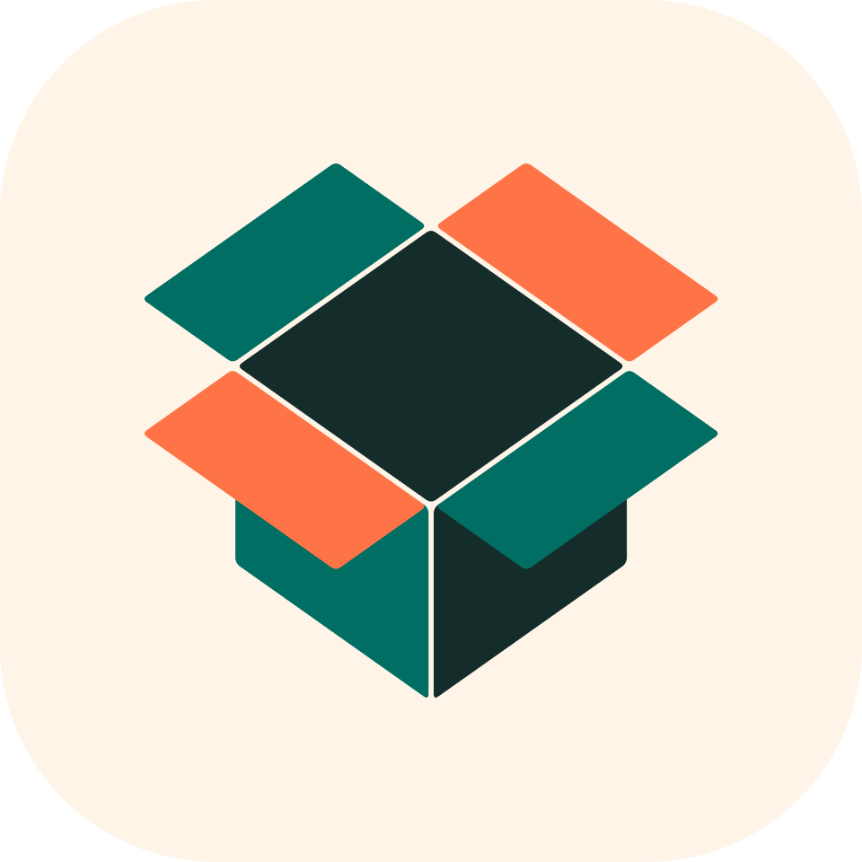
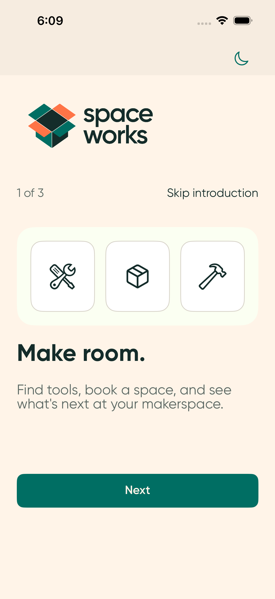
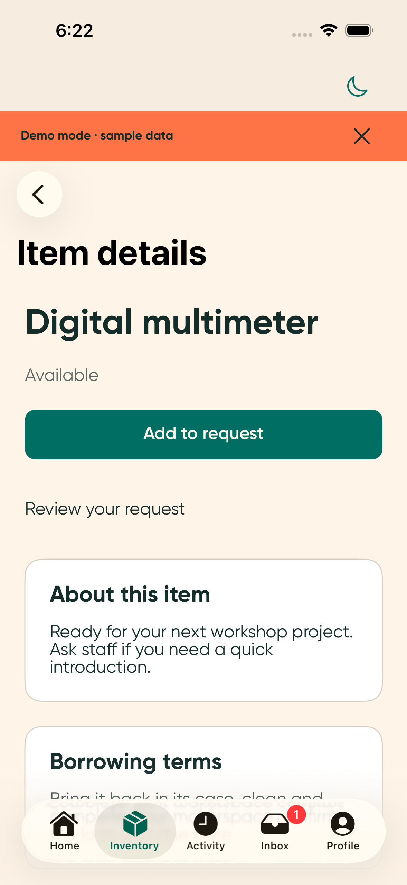
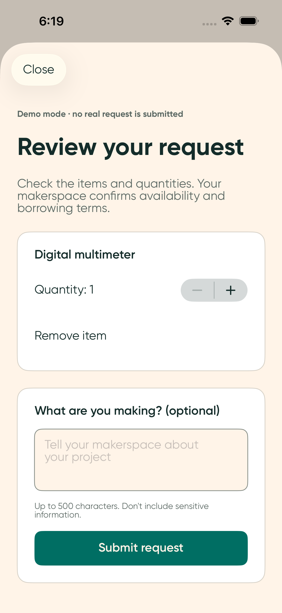
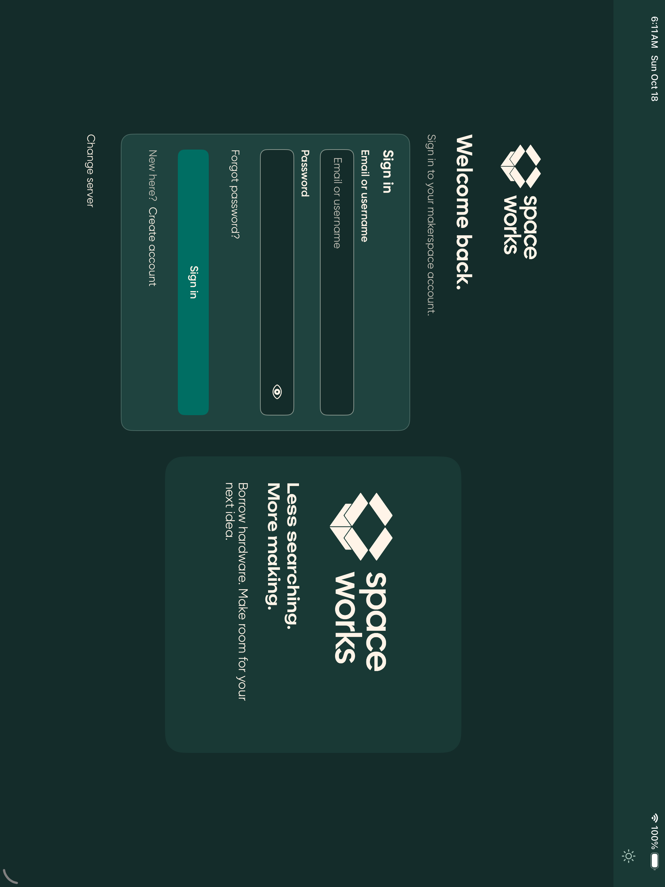
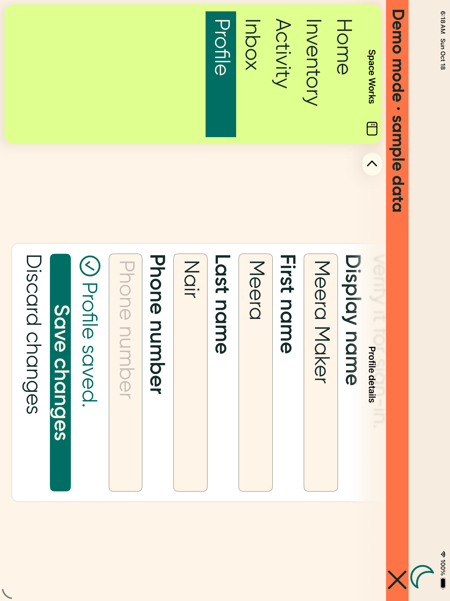

<p align="center">
  
</p>

# Space Works for iOS

A native SwiftUI app for makerspace members and staff, built for iPhone and iPad. Find equipment, review requests, manage bookings and keep track of your makerspace in one place.

[Android app](https://github.com/SpaceWorks-HQ/SpaceWorks-Android) · [Product requirements](docs/PRD.md) · [Phase history](docs/CHANGELOG.md) · [Release guide](docs/RELEASE-READINESS.md)

## Screenshots

Original, unmodified Simulator captures from the successful iPhone and large-iPad jobs at source `775f298`. This gallery documents those UI states; it is separate from final whole-matrix acceptance. The gallery includes explicitly labelled Debug sample flows; screenshots do not establish a live backend account or payment. [Capture provenance](docs/images/provenance.json) records the exact source commit, workflow run, artifact and image hash.

| Welcome | Equipment | Request review |
| --- | --- | --- |
|  |  |  |

| iPad in dark appearance | Largest text on iPad |
| --- | --- |
|  |  |

## What is included

| Area | App flows |
| --- | --- |
| Getting started | Optional introduction and replay, server selection, minimum-version gate, password, phone, Google, Apple and organization sign-in, MFA and account recovery |
| Member workspace | Makerspace switching, inventory and search, loans, requests, spaces, bookings, events, membership card and inbox |
| Member actions | Request review and submission, loan renewal, booking, event registration, tickets and profile/preferences |
| Account | Devices and sessions, sign out everywhere, phone/email verification, membership actions, export and whole-account deletion |
| Staff | Native staff sessions: permission-aware request review, handover, check-in, scanning and evidence entry |
| Platform integration | App Attest, Keychain storage, native document/share presentation, push v2 and universal-link routing, server-selected Stripe/Razorpay checkout |

Native navigation, forms and system bars adapt to phone and tablet layouts. Space Works semantic colors, supplied static artwork and Gilroy typography support light/dark appearance, Dynamic Type and Bold Text. Motion respects Reduce Motion; feedback follows native platform settings.

**Live flows use the pinned mobile backend contract** ([provenance](api/provenance.json)). Debug also includes an explicitly labelled, isolated in-memory demo for reviewing the flows; Release omits demo entry points. A few backend limitations remain unavailable by design (optional authenticator enrollment from a device, native provider linking, later pages of sessions/exports); see the [release guide](docs/RELEASE-READINESS.md). Live attestation, providers, push delivery, checkout and account deletion still require deployment configuration and real-device verification.

## Build locally

Use a Mac with **Xcode 26.2**, matching CI, and the **iOS 26 SDKs**. The app targets **iOS 17+**. Select the matching Xcode with `xcode-select` or `DEVELOPER_DIR`; Xcode 16.4 cannot compile the pinned Stripe SDK.

```sh
git clone --recurse-submodules https://github.com/SpaceWorks-HQ/SpaceWorks-iOS.git
cd SpaceWorks-iOS
git switch dev
brew install xcodegen librsvg
python3 scripts/check_build_tools.py
python3 scripts/generate.py
python3 -m unittest discover -s scripts/tests -v
python3 scripts/lint.py
xcodegen generate
python3 scripts/dependency_lock.py stage
open SpaceWorks.xcodeproj
```

Select the `SpaceWorks` scheme and an iPhone or iPad Simulator. Follow the [release guide](docs/RELEASE-READINESS.md#reproduce-the-app) for the exact native test command and simulator Keychain signing setup. Windows source checks do not establish an iOS build or test pass.

`project.yml` is the project source. The build plugin generates API client/models from a tested projection of `api/openapi.json`; generated Swift and Xcode projects are not committed. The authoritative contract stays byte-identical. [Contract provenance](api/provenance.json) records its source and hash.

## Validation

Delivery requires the exact source to pass **302 native state/API tests and 37 UI journeys on each of six configured profiles**, the unsigned physical-device Release/resource audit and actual full-OS visual review. The source gate also runs **45 Python checks**, catalog consistency and lint. Current results and downloadable evidence are available in [GitHub Actions](https://github.com/SpaceWorks-HQ/SpaceWorks-iOS/actions) and the existing delivery PR; pending or failed runs do not establish acceptance.

The [iOS workflow](.github/workflows/ios.yml) runs phone/tablet checks on each push. Its normal manual dispatch runs all six configured profiles; the separate one-case orientation diagnostic is not a complete validation run. Actual hardware/runtime metadata is retained with the artifacts.

Simulator tests and screenshots do not establish physical haptic feel, real camera behavior, live backend/provider operation or store readiness. An unsigned physical-device Release build proves compilation and resources, not signing or installation.

## Configuration and repository guide

Choose a server on launch, or lock one HTTPS origin in `branding/brand.json`. Debug-only local Docker origins are documented in [local validation](docs/LOCAL-DOCKER-VALIDATION.md). [White-label setup](docs/WHITE-LABEL.md) covers bundle identifiers, branding and deployment settings. Keep credentials, signing material and provider secrets outside the repository.

[Contributing](CONTRIBUTING.md) · [Security reporting](SECURITY.md) · [Reviewed dependency lock and tools](Dependencies/README.md)

| Path | Purpose |
| --- | --- |
| `SpaceWorks/` | SwiftUI screens, state and native adapters |
| `SpaceWorksTests/`, `SpaceWorksUITests/` | Native state/API tests and UI journeys |
| `api/` | Pinned OpenAPI contract and generation inputs |
| `branding/`, `tokens/` | App configuration and mobile motion settings |
| `design/` | Pinned, read-only Design submodule with supplied brand masters |
| `scripts/` | Source/resource generation, validation and device selection |
| `docs/` | Requirements, UX specification, phase history and release handoff |

Work is committed and pushed to `dev`. After native tests, unsigned Release checks and actual visual review pass, the tested work is merged into `main` through the owner's [iOS PR #4](https://github.com/SpaceWorks-HQ/SpaceWorks-iOS/pull/4). Ongoing work stays on `dev`. Backend and Design repositories are not modified by mobile development.

The supplied fonts and artwork retain their recorded provenance and applicable licensing. See [font provenance](SpaceWorks/Resources/Fonts/README.md) before redistributing brand assets.
